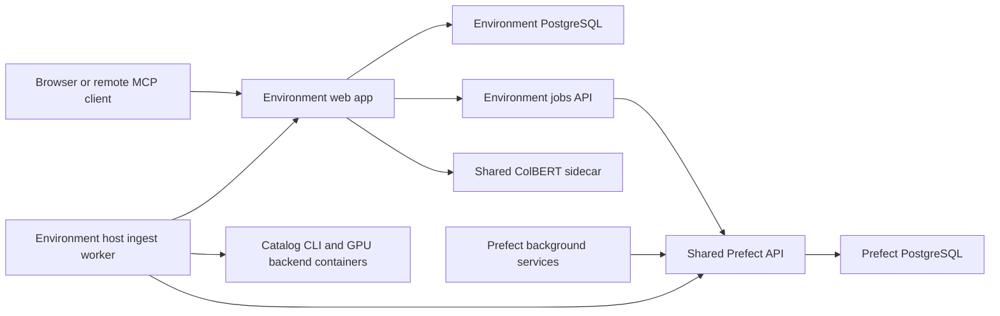

# Docker Container Topology

> **Status:** Current operational map

The web application, jobs API and host worker are selected per environment.
Prefect and the ColBERT query sidecar can be shared under the constraints below.
There is no containerized report-generation worker or provider-credential mount.

## Runtime map



The host worker executes ingestion, catalog-scoped removal and correction-index
sync on the same work pool. It needs the operator's Docker/GPU access and host
paths. The jobs API only validates/submits runs and reads execution state; it has
no Docker socket, GPU, host-data bind or provider credentials.

## Stacks and identities

| Stack | Source | Identity | Isolation |
| --- | --- | --- | --- |
| Web | `web/docker-compose.yml` plus mode overlays | `besedy-development`, `besedy-test`, `besedy-production` | Separate app/database and volume per mode |
| Jobs API | `jobs-service/docker-compose.jobs-{dev,test,prod}.yml` | `besedy-{dev,test,prod}-jobs-api` | Separate API secret, pool and deployment names per mode |
| Control plane | `jobs-service/docker-compose.prefect.yml` | `besedy-prefect-server`, `besedy-prefect-services`, `besedy-prefect-postgres` | Shared API/UI and orchestration database |
| Host worker | `jobs-service/host-worker/besedy-ingest-worker.service` | systemd user process | One environment's pool, callback URL and host configuration |
| ColBERT | `rag-services/docker-compose.yml` | `besedy-colbert` | Shared read service for explicitly selected catalog/index roots |
| GPU backends | `backends/docker-compose.yml` | CLI-managed backend containers | Host-launched audio/transcription/diarization/index work |

The web Compose wrapper fixes resource identity independently from runtime
`APP_ENV`, sanitizes inherited variables, and validates the rendered project,
container names, networks and database volume. Test instances may use an isolated
`test-*` project. Production never shares its database volume with dev/test.

The jobs wrapper similarly fixes its Compose files/environment and rejects pool
or deployment names belonging to another environment before creating resources.
Stop/inspect commands stay available for a miswired stack. Its startup recipes
remove orphan containers from that jobs project; the host worker and shared
control plane belong to other boundaries and are preserved.

## Networks and routing

- Each web stack has its own default network. Its database joins only that
  network; web joins that network plus `besedy-internal`.
- Each jobs API joins its own default network, `besedy-internal` and
  `besedy-prefect`. The shared Prefect containers join `besedy-prefect`.
- The host worker uses the control plane's loopback API and its selected web
  callback URL; it is not a member of a Docker bridge network.
- ColBERT joins its own default network (`br-bsdy-rag`) and `besedy-internal`.
  Its host port is loopback `127.0.0.1:8192`; web uses
  `RAG_COLBERT_URL=http://besedy-colbert:8192/query`.
- Bridge names start with `br-bsdy` and disable IPv6 so the existing host egress
  policy covers them. See [egress-isolation.md](egress-isolation.md).

A web app must call its own jobs API container:

| Environment | Jobs URL | Host API port | Host-worker pool |
| --- | --- | --- | --- |
| Development | `http://besedy-dev-jobs-api:8390` | `127.0.0.1:8390` | `besedy-ingest-dev` |
| Test | `http://besedy-test-jobs-api:8390` | `127.0.0.1:8392` | `besedy-ingest-test` |
| Production | `http://besedy-prod-jobs-api:8390` | `127.0.0.1:8391` | `besedy-ingest-prod` |

Never use the shared Compose alias `jobs-api`: all environments on
`besedy-internal` advertise it. `besedy-jobs-api` is development-only. The web
wrapper rejects ambiguous or cross-environment jobs hosts. Secrets must match
between the selected web app, jobs API and host worker.

## ColBERT sharing

The sidecar mounts `${BESEDY_STATE_HOME}/tmp/rag_colbert` at
`/data/state/rag_colbert`, with model caches in `besedy_colbert_model_cache` and
`besedy_colbert_torch_cache`. Its preload comes from the resolved
`rag-services.env`; prefer the stable `index/colbert_index` symlink.

Sharing is suitable only when the environments intentionally query the same
catalog/index roots and coordinate updates. Use a separate stack or host port
for new formats, models, chunking, destructive rebuilds or load experiments
that could affect production. Source roots and model selection remain explicit.

## Deployment inventory and checks

On the target host, confirm each web app has its own database and jobs API,
expected loopback bindings, and the intended internal network. Confirm all three
remaining deployments use the environment's ingest pool, with an online host
worker. The shared Prefect database volume is external and is not removed by
`prefect-down`.

```bash
docker network inspect besedy-internal \
  | jq -r '.[].Containers | to_entries[] | .value.Name'
docker exec besedy-production-web wget -qO- http://besedy-prod-jobs-api:8390/health
curl -fsS http://127.0.0.1:8391/health
curl -fsS http://127.0.0.1:8192/health
curl -fsS http://127.0.0.1:3000/api/health
systemctl --user status besedy-ingest-worker
```

The production internal network includes `besedy-production-web`,
`besedy-prod-jobs-api` and `besedy-colbert`; it may also contain the explicitly
configured dev/test services. The production database is not on that network.

See [operations.md](operations.md#jobs-production-runtime) for deployment,
retiring old runtime resources, version checks and recovery; see
[recording-ingest.md](recording-ingest.md#host-worker) for host-worker setup.
